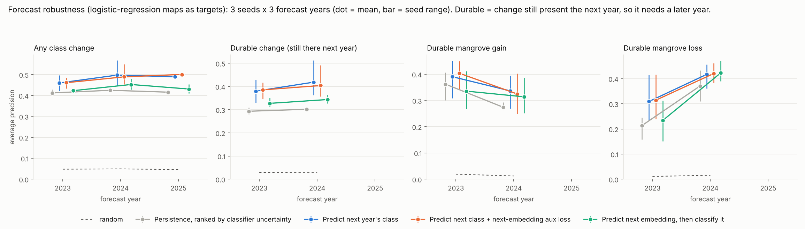

# Mapping and forecasting mangroves from AlphaEarth embeddings

## Abstract
We ask what model is needed to map mangroves from Google's AlphaEarth annual embeddings
(`GOOGLE/SATELLITE_EMBEDDING/V1/ANNUAL`, 64 bands, 10 m), whether it holds up in regions it was
not trained on, and whether the embeddings can forecast next year's land cover. Across 11 coastal
regions:

- **A per-pixel model is enough.** With one region held out, logistic regression (715 parameters),
  a pixel MLP, a dilated FCN and SegFormer-B0 all score 0.82-0.84 mangrove IoU. That gap is
  smaller than the seed-to-seed spread. kNN, the earlier baseline, scores 0.76.
- **Spatial context adds nothing.** Receptive fields from 10 m to 1.27 km score the same within
  noise. The embeddings already encode their surroundings.
- **Regularization is what transfers.** On Baja California, a region left out of training, a
  per-pixel MLP with BatchNorm and dropout reaches IoU 0.85, the same as logistic regression.
  Without regularization the MLP drops to 0.64-0.75.
- **Embeddings forecast change.** From the two prior years, a per-pixel MLP ranks next year's class
  changes at AP 0.46-0.50, against 0.41-0.43 for persistence and 0.05 for random. It ranks
  durable change (still there a year later) at 0.38-0.42, against 0.29-0.30.
- **But much of the change is not land cover.** A fifth of detected change is tidal flat to water,
  caused by tide stage. Global Mangrove Watch's own year-to-year changes are barely visible in the
  embeddings (AP ≤ 0.05).

The classifier and forecaster ship as one model file that maps, forecasts and detects change from
exported GeoTIFFs ([§6](#6-use-the-change-models)). Full results: [`results/README.md`](results/README.md).


*Figure 1. Mangrove IoU on the held-out region (bar = mean, dot = one seed). Jamaica is the
hardest region and the one where logistic regression falls behind.*

## 1. Data and methods
- **Inputs:** AlphaEarth annual embeddings on each region's native UTM 10 m grid.
- **Labels:** 11 exclusive classes, a Python port of the v3 Code Editor script
  (`legacy/mangrove_training_knn.js`), built from existing global products:

  | class | source |
  |---|---|
  | 1 mangrove | Global Mangrove Watch (GMW) v3 extent |
  | 2 salt marsh | GWL_FCS30 wetland map (186) and ESA WorldCover (90) |
  | 3 tidal flat | GWL_FCS30 (187) and WorldCover (60 / 80 / 90) |
  | 4 water, 5 seasonal water | JRC Global Surface Water: ≥ 10 / 1-9 months a year |
  | 6 built-up | WorldCover (50) or GHSL built-up ≥ 50% |
  | 7 barren, 8 coastal forest, 9 cropland | WorldCover (60, 10, 40) |
  | 10 herbaceous wetland, 11 other land | WorldCover (90; 20 / 30 / 70 / 100) |

  Pixels that WorldCover or GWL_FCS30 call mangrove but the label does not are masked as ambiguous. Non-mangrove
  classes are only sampled within 5 km of mangrove.
- **Training labels per experiment:**
  - **Mapping (2.1-2.3):** these labels for **2020**, the last GMW v3 year.
  - **Change (2.4):** a classifier is first fit on these labels for **2017-2020** (the GMW v3
    years that have embeddings). Its map for every year from 2017 to 2025 is then the target the
    forecasters learn. Three classifiers are used: an MLP trained inside the change run (Fig. 3),
    logistic regression (Fig. 4 and the shipped model) and a regularized per-pixel MLP trained
    with `train-seg` on all 11 regions (Fig. 5). Training forecasters directly on the labels
    fails (see 2.4).
- **Regions:** Sundarbans, Mekong, Mahakam, Matang, Niger Delta, Pará, Papua, Everglades, Rufiji,
  Jamaica, Mexico Pacific (`configs/default.yaml`), plus Baja California north as an unseen test region.
- **Samples:** 128 × 128 px chips (1.28 km), 300 per region, half centred on mangrove.
- **Protocols:**
  - Leave one region out (LORO): Everglades, Jamaica, Mekong or Sundarbans held out.
  - Pooled: all regions, tested on held-out ~5 km blocks.
  - Unseen region: pooled training without Mexico Pacific, tested on Baja north.
- **Metric:** mangrove IoU; average precision (AP) when ranking. Seeds 0-2 unless noted.
- **Change:** matched pixels for 2017-2025 (400 chips per region, 100 centred on GMW change).
  Forecasters see the embeddings of the k prior years and are tested on held-out blocks.

## 2. Results
### 2.1 Model choice
| model | params | LORO IoU | pooled IoU |
|---|---|---|---|
| dilated FCN, 630 m context | 190k | 0.84 | — |
| per-pixel FCN | 185k | 0.83 | 0.91 |
| SegFormer-B0 | — | 0.83 | — |
| logistic regression | 715 | 0.83 | 0.90 |
| pixel MLP 128-64 | 17.5k | 0.82 | 0.90 (with BN + dropout) |
| kNN (k = 5) | — | 0.76 | — |

When a region is in training, logistic regression and the regularized MLP tie in every region
(within 0.02). Logistic regression's weakness in Jamaica (0.58) appears only when Jamaica is unseen.

### 2.2 Spatial context

*Figure 2. Left: Mekong IoU vs FCN receptive field; the curve is flat within one configuration's
seed range (0.73-0.82). Right: 10 m vs 630 m on matched splits, mean difference ≈ 0.*

Adding mean-pooled neighbourhoods (30-310 m) to the regularized MLP changes IoU by +0.001 to
+0.006 in-region and −0.017 to 0 on Baja.

### 2.3 Unseen region (Baja California north)
| model | IoU | AP |
|---|---|---|
| per-pixel FCN | 0.850 | 0.968 |
| **MLP 128-64 + BatchNorm + dropout 0.1** | **0.849** | 0.969 |
| logistic regression | 0.846 | 0.966 |
| MLP 128-64, no regularization | 0.64-0.75 | 0.946 |

### 2.4 Forecasting change

*Figure 3. Forecasting 2025 from 2023-2024, with MLP-classifier maps as targets: how well each
method ranks the pixels that change. Learned forecasters (blue) beat every baseline (grey).*

- **Predict the class directly.** Predicting the embedding first is worse; an auxiliary
  next-embedding loss, or giving the model this year's map, adds nothing.
- **Two prior years beat one; three add nothing.**
- **The labels themselves cannot be forecast.** Trained directly on the yearly labels
  (forecasting 2020), every method ranks mangrove change near random (AP ≤ 0.05). About 70% of
  that label change is tidal flat ↔ water flicker in GWL_FCS30, and GMW's yearly mangrove
  changes are barely visible in the embeddings. Hence the classifier maps as targets.
- **Accuracy does not move** (0.94, same as persistence). What improves is *where* change is
  expected: the forecaster gets the new class right on 35% of changed pixels.


*Figure 4. Logistic-regression maps as targets, water and tidal flat merged, three seeds × three
forecast years. The forecaster
(blue) beats persistence (grey) every year, by more on durable change. The mangrove-specific
margins are within seed spread in some years.*


*Figure 5. Regularized-MLP maps as targets. Left: what changing pixels become. Tidal flat → water
alone is 21% of change.
Right: forecasting helps most for barren, other land, tidal flat and mangrove, and not at all for
water, salt marsh or cropland.*

## 3. Limitations
- LORO covers 4 regions; SegFormer, logistic regression and kNN in Table 2.1 are single runs.
- Change targets are classifier maps, so some "change" is flicker on borderline pixels.
  Merging water with tidal flat and scoring durable change reduce this but do not remove it.
- Mangrove thresholds tuned on training regions do not transfer, so we report argmax.

## 4. Conclusion
Use a regularized per-pixel MLP (or logistic regression) on the raw embeddings. It matches
segmentation models, deploys as a per-pixel operation in Earth Engine, and is the safest choice on
a new coast. The same embeddings carry a usable, though tide-contaminated, signal of next year's
change.

## 5. Reproduce
```bash
pip install -e ".[dev]"            # extras: seg (torch, transformers<5), deploy, track (wandb)
mangrove auth                      # one-time Earth Engine login
mangrove demo                      # check the install on synthetic data, no Earth Engine
```
The Earth Engine project defaults to `intricate-web-334523` (`configs/default.yaml`; override
with `EE_PROJECT`).

| result | commands |
|---|---|
| point diagnostics (`results/point_diagnostics/`) | `mangrove extract`, `mangrove diagnose` |
| 2.1 model comparison | `mangrove chips`, `mangrove train-seg --protocol loro\|pooled [--model fcn\|mlp]`, `mangrove compare-pixel`, `mangrove bench`, `mangrove compare-seg` |
| 2.2 spatial context | `mangrove train-seg --model fcn --fcn-dilations ...`, `python scripts/context_sweep.py` |
| 2.3 unseen region | `mangrove --config configs/baja_test.yaml chips`, `mangrove eval-seg --chips data/test/chips` |
| 2.4 change | `mangrove temporal-chips`, `mangrove change --labels logreg --history 2` |
| figures | `mangrove plots` |

Every command has `--help`. Runs resume, and each variant writes its own results folder.
- **Hardware:** CUDA, Apple MPS and CPU are picked automatically (`--device` to force).
- **Tracking:** `--wandb` logs to Weights & Biases (`pip install -e ".[track]"`).

## 6. Use the change models
`models/change_logreg_k2.pt` holds the logistic-regression classifier and the 2-year forecaster
(2025 holdout: change AP 0.49, mangrove IoU 0.95). It refuses to load if the model code no longer
reproduces its stored reference outputs. Install with `pip install -e ".[deploy]"`.

**Inputs:** one 64-band AlphaEarth GeoTIFF per year, all on one grid. Export them from Earth
Engine:
```python
import ee; ee.Initialize(project="<your-project>")
BANDS = [f"A{i:02d}" for i in range(64)]
region = ee.Geometry.Rectangle([lon_min, lat_min, lon_max, lat_max])
col = ee.ImageCollection("GOOGLE/SATELLITE_EMBEDDING/V1/ANNUAL").filterBounds(region)
p = col.first().select(0).projection().getInfo()          # native UTM 10 m grid, shared by all years
for y in (2023, 2024, 2025):
    img = col.filterDate(f"{y}-01-01", f"{y + 1}-01-01").mosaic().select(BANDS).toFloat()
    ee.batch.Export.image.toDrive(img, description=f"emb_{y}", region=region, crs=p["crs"],
                                  crsTransform=p["transform"], maxPixels=1e10).start()
```
If the export is split into several files, merge them with `gdalbuildvrt` and pass the VRT.

```bash
# forecast 2026 from 2024-2025
mangrove change-predict --bundle models/change_logreg_k2.pt --inputs emb_2024.tif emb_2025.tif --out out/f2026
# what changed between 2023 and 2025
mangrove change-detect --bundle models/change_logreg_k2.pt --before emb_2023.tif --after emb_2025.tif --out out/d23_25
```
| output | contents |
|---|---|
| `f2026_classes.tif` | current class, forecast class (codes 1-11; 3 = tidal flat + water; 255 = no data) |
| `f2026_probs.tif` | `p_change`, `p_mangrove` next year; `--probs` adds every class |
| `d23_25_classes.tif` | class before, class after |
| `d23_25_probs.tif` | `p_change`, `p_mangrove_gain`, `p_mangrove_loss`, `cosine` (embedding similarity) |
| `d23_25_transitions.csv`, `d23_25_classes.csv` | area (ha) per from → to pair and per class; pixels with `p_change ≥ --min-p` (0.5) |

To rebuild the bundle, run `mangrove change --labels logreg --history 2 --save-bundle
models/change_logreg_k2.pt`. Keep the default `--methods`: this run writes to the benchmark's
results folder.

## Repository
```
configs/          regions, sampling, tiling
src/mangrove_embed/
  extract.py      Earth Engine -> labeled points (parquet)
  chips.py        Earth Engine -> dense chips;  temporal.py: multi-year chips
  diagnostics.py  point diagnostics
  seg/            SegFormer (64-band stem), FCN, MLP; multi-region training
  change.py       change forecasting;  deploy.py: model file, change-predict / change-detect
  plots.py        figures;  cli.py: `mangrove` command
scripts/          sweeps and W&B exports
results/          numbers and figures (index: results/README.md)
models/           shipped change model
legacy/           v3 Code Editor kNN + change baseline (reference)
```
