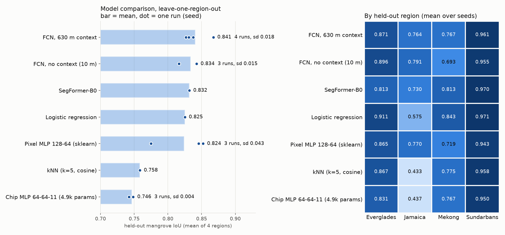
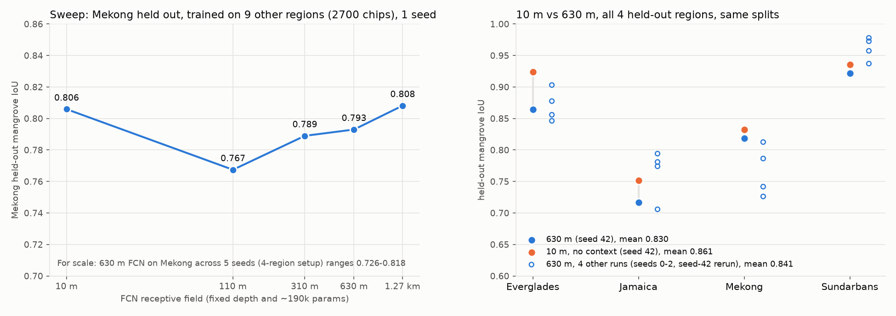

# Results

**Question:** what model do we need to map mangroves from Google AlphaEarth embeddings (64-band,
10 m), and does it hold up in a region it has never seen?

**Answer:** a per-pixel model is enough. Spatial context and large models add nothing.
Logistic regression and a small regularized MLP tie. The MLP holds up better on a region
unlike anything in training.

## Methods
- **Data:** 128 x 128 px chips (1.28 km) from 11 regions, labeled with Global Mangrove Watch v3 (2020).
- **Metric:** mangrove IoU on held-out pixels; AP reported where useful.
- **Protocols:**
  - **LORO** (leave one region out): train on 3 regions, test on the 4th (Everglades,
    Jamaica, Mekong, Sundarbans).
  - **Pooled:** train on all regions, test on held-out spatial blocks in each.
  - **Unseen region:** train pooled, test on Baja California north (`baja_north`, 300 chips)
    with `mexico_pacific` left out of training.
- **Seeds:** 0-2 for most numbers; SegFormer, logreg and kNN in section 1 are single runs.

## 1. Model comparison (LORO, 4 regions)

| model | params | mean IoU |
|---|---|---|
| dilated FCN, 630 m context | 190k | 0.845 |
| per-pixel FCN, 10 m (no context) | 185k | 0.834 |
| SegFormer-B0 | - | 0.832 |
| logistic regression | 715 | 0.825 |
| pixel MLP 128-64 | 17.5k | 0.824 |
| kNN (k=5) | - | 0.758 |

The top five are within 0.02 of each other, less than the seed-to-seed spread (sd 0.015-0.043).
Jamaica is the hardest region: logreg 0.575 vs 0.77-0.79 for the nonlinear models.

## 2. Spatial context does not help

- **Matched seeds:** 630 m vs 10 m receptive field differs by +0.025, -0.005, +0.014 and
  -0.031, a mean of about 0.
- **Mekong sweep** (10 m to 1.27 km): flat (0.767-0.808), inside one config's seed spread.

## 3. Unseen region: Baja California north
Mean IoU over seeds; training excludes `mexico_pacific`.

| model | Baja IoU | AP |
|---|---|---|
| per-pixel FCN | 0.852 | 0.968 |
| **MLP 128-64 + BatchNorm + dropout 0.1** | **0.849** | 0.969 |
| logistic regression | 0.846 | 0.966 |
| MLP 128-64, no regularization | 0.636-0.747 | 0.946 |

Regularization matters: without it the MLP overfits its training regions.

## 4. Logreg vs regularized MLP (pooled, 10 regions, identical splits)
| | logreg | MLP + BN + dropout |
|---|---|---|
| mean IoU | 0.898 | 0.898 |
| Jamaica | 0.849 | 0.855 |
| weakest (Rufiji) | 0.756 | 0.732 |

When a region is in training, the two tie everywhere (all regions within 0.02). Logreg's Jamaica
weakness only appears when Jamaica is unseen (LORO).

## 5. Side probes
- **Calibration** (`calibration/`):
  - Per-region feature centering or EM prior adaptation lowers mean LORO IoU (logreg 0.813 raw
    vs 0.72-0.77).
  - The exception is EM on logreg in Jamaica (0.54 -> 0.76).
- **kNN k sweep:** flat from k=5 to k=200 (0.755-0.763).
- **Point diagnostics** (`point_diagnostics/`): an earlier probe on sampled points (Q1-Q4:
  geometry, false-positive sources, domain gap, mean-pooled context).

## Conclusion
- **Model choice:** use the regularized per-pixel MLP. It ties logistic regression where the
  region is in training and is safer on a novel one.
- **Dropped:** FCN and SegFormer.
- **Weakest regions:** Rufiji, Mekong and Jamaica (0.73-0.86 pooled).

## Files
| folder | contents | made by |
|---|---|---|
| `model_comparison/` | one folder per run: `summary.csv` + per-split JSON | `train-seg`, `compare-pixel`, `compare-seg` |
| `receptive_field/` | `rf_runs.csv` (W&B export) | `scripts/export_rf_wandb.py` |
| `generalization/` | Baja scores | `eval-seg`, `compare-pixel --test-chips` |
| `calibration/` | calibration + kNN sweep | `scripts/calibration_probe.py`, `knn_k_sweep.py` |
| `point_diagnostics/` | Q1-Q4 | `mangrove diagnose` |

Figures: `mangrove plots`. Model weights (`*.pt`) are not versioned.
