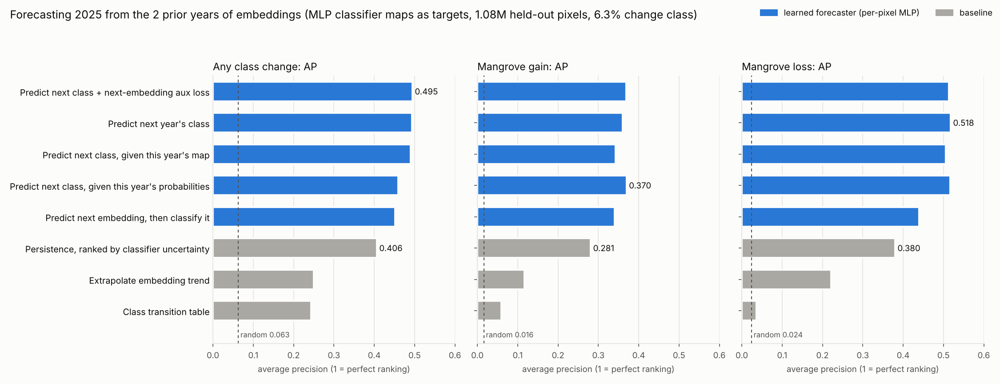
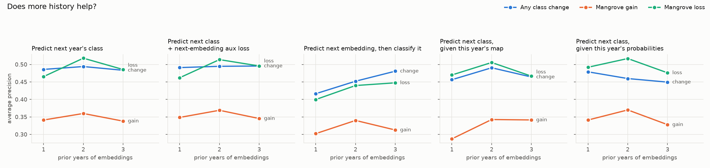
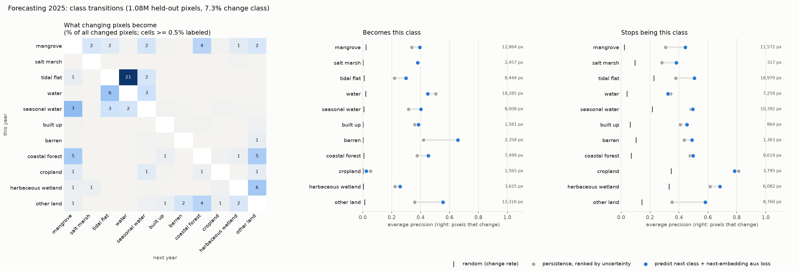

# Results

**Question:** what model do we need to map mangroves from Google AlphaEarth embeddings (64-band,
10 m), and does it hold up in a region it has never seen?

**Answer:** a per-pixel model is enough. Spatial context and large models add nothing.
Logistic regression and a small regularized MLP tie. The MLP holds up better on a region
unlike anything in training.

## Methods
- **Data:** 128 x 128 px chips (1.28 km) from 11 regions, labeled with Global Mangrove Watch v3 (2020).
- **Metric:** mangrove IoU on held-out pixels; AP reported where useful.
- **Protocols:**
  - **LORO** (leave one region out): train on 3 regions, test on the 4th (Everglades,
    Jamaica, Mekong, Sundarbans).
  - **Pooled:** train on all regions, test on held-out spatial blocks in each.
  - **Unseen region:** train pooled, test on Baja California north (`baja_north`, 300 chips)
    with `mexico_pacific` left out of training.
- **Seeds:** 0-2 for most numbers; SegFormer, logreg and kNN in section 1 are single runs.

## 1. Model comparison (LORO, 4 regions)

| model | params | mean IoU |
|---|---|---|
| dilated FCN, 630 m context | 190k | 0.845 |
| per-pixel FCN, 10 m (no context) | 185k | 0.834 |
| SegFormer-B0 | - | 0.832 |
| logistic regression | 715 | 0.825 |
| pixel MLP 128-64 | 17.5k | 0.824 |
| kNN (k=5) | - | 0.758 |

The top five are within 0.02 of each other, less than the seed-to-seed spread (sd 0.015-0.043).
Jamaica is the hardest region: logreg 0.575 vs 0.77-0.79 for the nonlinear models.

## 2. Spatial context does not help

- **Matched seeds:** 630 m vs 10 m receptive field differs by +0.025, -0.005, +0.014 and
  -0.031, a mean of about 0.
- **Mekong sweep** (10 m to 1.27 km): flat (0.767-0.808), inside one config's seed spread.
- **Regularized MLP + mean-pooled neighbourhood** (30 m to 310 m windows, pooled 10 regions,
  seeds 0-2): +0.001 to +0.006 IoU in-region, -0.017 to 0.000 on Baja (`context/mlp_context.csv`).

## 3. Unseen region: Baja California north
Mean IoU over seeds; training excludes `mexico_pacific`.

| model | Baja IoU | AP |
|---|---|---|
| per-pixel FCN | 0.850 | 0.968 |
| **MLP 128-64 + BatchNorm + dropout 0.1** | **0.849** | 0.969 |
| logistic regression | 0.846 | 0.966 |
| MLP 128-64, no regularization | 0.636-0.747 | 0.946 |

Regularization matters: without it the MLP overfits its training regions.

## 4. Logreg vs regularized MLP (pooled, 10 regions, identical splits)
| | logreg | MLP + BN + dropout | per-pixel FCN |
|---|---|---|---|
| mean IoU | 0.898 | 0.898 | 0.910 |
| Jamaica | 0.849 | 0.855 | 0.853 |
| weakest (Rufiji) | 0.756 | 0.732 | 0.762 (0.61-0.98 by seed) |

When a region is in training, logreg and the MLP tie everywhere (all regions within 0.02); the
FCN is ~0.01 higher on average but less stable (Rufiji). Logreg's Jamaica
weakness only appears when Jamaica is unseen (LORO).

## 5. Side probes
- **Calibration** (`calibration/`):
  - Per-region feature centering or EM prior adaptation lowers mean LORO IoU (logreg 0.813 raw
    vs 0.72-0.77).
  - The exception is EM on logreg in Jamaica (0.54 -> 0.76).
- **kNN k sweep:** flat from k=5 to k=200 (0.755-0.763).
- **Point diagnostics** (`point_diagnostics/`): an earlier probe on sampled points (Q1-Q4:
  geometry, false-positive sources, domain gap, mean-pooled context).

## 6. Change prediction: forecasting next year's map
Matched 10 m pixels for 2017-2025 (400 chips per region, 100 of them centred on GMW change).
Targets are our classifier's maps (trained on GMW 2017-2020); forecast **2025** on held-out
blocks from earlier years. 6.3% of pixels change class; 1.6% gain and 2.4% lose mangrove.
Scored by how well each method ranks the pixels that change (AP; random = the change rate).

- **Learned forecasters beat every baseline**, at about 8x random for any change and 22x for
  mangrove gain / loss. The best: change AP 0.495, gain 0.370, loss 0.518, against 0.41 / 0.28 /
  0.38 for persistence ranked by classifier uncertainty.
- **Predicting the class directly is best.** The next-embedding aux loss adds nothing; predicting
  the embedding first is worse. Giving this year's map adds nothing (it comes from the embedding).
- **Overall accuracy does not move** (0.94 for all, as persistence), but the best model gets the
  new class right on 35% of changed pixels.
- **Caveat:** part of the change is classifier flicker on borderline pixels, not land-cover change.

Two prior years beat one; three add nothing.

**Full class spread** (`change/change_model_k2_s0/`): targets from the regularized per-pixel MLP
(128-64, BatchNorm, dropout 0.1) trained on all 11 regions, frozen; same test (2025, 2 prior years).
7.3% of pixels change; the best forecaster (next class + next-embedding aux loss) has change AP
0.494 vs 0.399 for uncertainty-ranked persistence.

- **Tidal flat -> water is a fifth of all change** (21%), even with classifier labels: tide stage
  in the yearly embedding, not land-cover change. Water -> tidal flat adds another 6%.
- **Into mangrove** comes mostly from seasonal water (7%) and coastal forest (5%); **out of
  mangrove** spreads over coastal forest, water, tidal flat and seasonal water (2-4% each).
- **Forecasting helps most for barren, other land, tidal flat and mangrove** (entering AP up to
  0.66 vs 0.42 for barren); it adds nothing for water, salt marsh and cropland.

With GMW-based labels instead (forecast 2020), every embedding-only method ranks mangrove
change near random (gain / loss AP <= 0.05): about 70% of the label change is tidal flat <->
water flicker in GWL, and GMW's yearly mangrove changes are barely visible in the embeddings.

## Conclusion
- **Model choice:** use the regularized per-pixel MLP. It ties logistic regression where the
  region is in training and is safer on a novel one.
- **Dropped:** FCN and SegFormer.
- **Weakest regions:** Rufiji, Mekong and Jamaica (0.73-0.86 pooled).

## Files
| folder | contents | made by |
|---|---|---|
| `model_comparison/` | one folder per run: `summary.csv` + per-split JSON | `train-seg`, `compare-pixel`, `compare-seg` |
| `receptive_field/` | `rf_runs.csv` (W&B export) | `scripts/export_rf_wandb.py` |
| `generalization/` | Baja scores | `eval-seg`, `compare-pixel --test-chips` |
| `calibration/` | calibration + kNN sweep | `scripts/calibration_probe.py`, `knn_k_sweep.py` |
| `point_diagnostics/` | Q1-Q4 | `mangrove diagnose` |
| `context/` | regularized MLP + spatial context sweep | `scripts/context_sweep.py` |
| `change/` | change prediction, one folder per run (`clf` = classifier-map targets, `k` = prior years) | `mangrove temporal-chips`, `mangrove change` |

Figures: `mangrove plots`. Model weights (`*.pt`) are not versioned.
